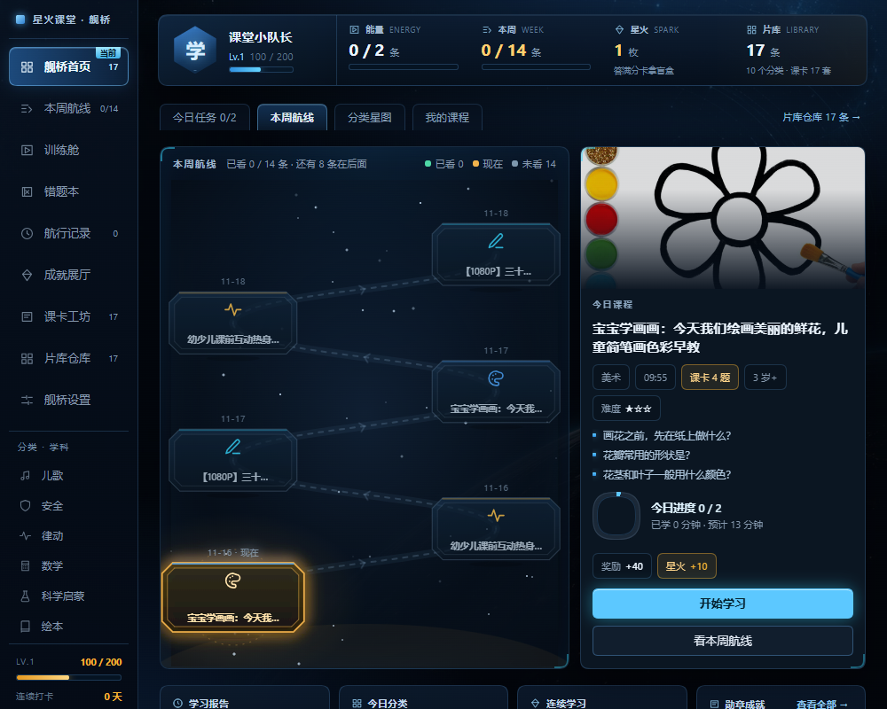

# Spark Classroom · dsh-bili-lesson

[中文](./README.md) | **English**

A Bilibili learning panel for your own kid, mounted in the sidebar of the
[DeepSeek Harness](https://github.com/deepseek-ai) desktop app:
**parent picks the clips → the week gets scheduled → the kid watches and ticks it off → a quiz card goes with the clip → submit and get scored → missed questions come back → blind boxes and medals**.

It is not a recommendation algorithm and not a question generator — the parent chooses every clip and writes every question. The plugin is only the machine that does *schedule + check-in + grading + rewards*.



## What it does

| Page | What it does |
|---|---|
| Bridge home | Today's tasks / this week's arc route / category star map; the "current course" card on the right carries cover, learning goals, progress and a "start learning" button |
| Today Island | A kid-facing task island: finished items push a rocket around the island, and finishing everything lights the beacon |
| Mistake Hospital | Wrong answers as little monsters: one correct retry lowers HP, two in a row send it to the recovery album |
| Parent cockpit | Five signals plus one actionable sentence; the weekly growth poster is generated locally and never uploaded; also behind the PIN lock |
| Vault (library) | Paste a BV id or a full Bilibili link to add a clip; you fill in category, minimum age and your own reason; "check dead" probes the whole library at once |
| This week's route | Seven days of scheduling — "auto schedule" (rotates categories, skips dead clips and anything used in the last three weeks) or swap a clip by hand |
| Log | Tick clips off day by day; this week's count, streak, last 7 days as bars |
| Training bay | Official player plus this week's clip list on the left, the quiz card on the right; answer question by question, submit and get scored — 80 points earns one blind box that day |
| Mistakes | Every question missed on submit lands here automatically; tap an option to redo it on the spot, a correct answer marks it "mastered" |
| Family weekly (API) | `GET /bili-lesson/family/weekly` is a read-only weekly rollup of clips watched, answers, recovered mistakes, medals and boxes; the parent cockpit and growth poster read from it |
| Medal hall | 8 medals (granted automatically when a threshold is met, progress shown until then) + blind box + prize pool + recent draws |
| Card workshop | One quiz card per video, 3–8 questions each |
| Bridge settings | Clips per day / default age / weekly box cap; the 54-item prize pool with stock and weights; medal thresholds; **parent-lock PIN** |

## Where the clips and questions come from

This plugin **has no built-in search and does not write questions for you**: the library and the question bank are yours to feed.
Every detail (endpoints, fields, limits, traps) is in [docs/HOW-TO-CURATE.md](./docs/HOW-TO-CURATE.md) (Chinese); the gist:

**Clips**

- Paste a BV id or a whole Bilibili link in the Vault → the server calls the public read-only endpoint
  `GET https://api.bilibili.com/x/web-interface/view?bvid=…` with a referer header and **no cookie, no login, no stream proxying**,
  to fill title / cover / duration / uploader. Category, minimum age and the "why" note are yours. Taken-down videos are marked `dead`
  but never removed from your library.
- No built-in search: Bilibili search needs a wbi signature and a plain GET returns HTTP 412, so you curate outside the plugin
  (search on Bilibili and copy the link / ask an AI assistant for a list / copy a `videos.json` from somewhere else).
- The data source is a **single replaceable function**: only `fetchVideo(bvid)` in `src/bili.js:20` talks to Bilibili. Point it at a
  third-party API (TikHub, your own proxy, an internal mirror) and nothing else changes. There is no "API key" settings page yet - see
  Known limitations below for why.

**Questions**

- One card per video in the Card workshop, **3-8 questions**. Fields: `prompt` (dropped if empty) / `spokenPrompt` (defaults to the prompt) /
  `options` (2-6; **fewer than 2 silently becomes yes/no**) / `answer` (index of the correct option, out of range falls back to 0) /
  `hint` / `explanation` / `difficulty` (clamped to 1-3).
- Every question weighs the same; 80% or more on the day earns one blind box. Wrong answers land in Mistakes keyed by `lessonId:qid`.
- Three rules that keep questions fair: one idea per question, options equal in length and shape, distractors taken from what the video
  actually mixes up (6 vs 9, not 100).
- You can also edit `lessons.json` directly (see Data); the Training bay finds a card as long as `videoId` matches a BV id in the library.
## Requirements

- DeepSeek Harness desktop **0.2.2-rc.x** (verified on 0.2.2-rc.3). The plugin loads through a cordis patch and the client-side
  `__ModuleLoader__` factory, and relies on `@deepseek-ai/dsh-client-runtime` injection, so **a major platform bump may require changes here**.
- Node 24 / pnpm (the runtime shipped with DSH is fine). The plugin has no third-party dependencies besides `react`.

## Install

```powershell
git clone <this repo> dsh-bili-lesson
cd dsh-bili-lesson
pwsh -ExecutionPolicy Bypass -File .\install.ps1
```

The script backs up the profile's `package.json`, registers the plugin as a `link:` dependency, appends it to
`dsh.profile.bundles`, and runs `pnpm install` once. Then **quit the desktop app completely and start it again**
(tray icon included) — "星火课堂" appears in the sidebar. To undo, run the same command with `-Uninstall`.

The same thing by hand:

```powershell
# 1. edit $env:USERPROFILE/.dsh/profiles/desktop/package.json
#    dependencies["dsh-bili-lesson"] = "link:<absolute path to this repo, forward slashes>"
#    append "dsh-bili-lesson" to dsh.profile.bundles
# 2. cd "$env:USERPROFILE/.dsh/profiles/desktop"; pnpm install
# 3. restart the desktop app
```

> Installed under the older name (`@local/dsh-bili-lesson`)? The script removes the stale registration for you.

## Running without DSH (standalone)

`standalone/` is the same panel without the host: install Node, double-click `standalone/start.bat`,
and the browser opens `http://127.0.0.1:7788/`. No business code changed — it just provides the two
things DSH normally does (an HTTP server and the React mount).

First launch seeds a 30-clip demo library (four themed weeks, one clip a day), so it is not empty —
handy for showing a kindergarten or a parent. Node 24 required.

## Self-check

```powershell
npm run check        # node --check on eight files
npm test             # boots a real HTTP server and runs selftest (85 cases; it really calls the Bilibili view API once)
npm run check:load   # simulates the DSH loader: server and client both load, factory id == package name
```

## Data

Everything stays local in `~/.dsh/bili-lesson/` (`BILI_LESSON_HOME` overrides it). No cloud sync, no telemetry:

| File | Contents |
|---|---|
| `videos.json` | the library, keyed by BV id |
| `plans.json` | per-week plan, keyed by the Monday date |
| `watch.json` | viewing records (the ticks) |
| `lessons.json` | quiz cards |
| `settings.json` | clips per day / default age / embedded playback / weekly box cap / parent lock |
| `attempts.json` | submissions (per question qid / choice / correct, score, whether a box was granted) |
| `mistakes.json` | mastery state per missed question (`lessonId:qid` → resolved / tries / lastChoice / at) |
| `rewards.json` · `honors.json` | draw history / medals already granted |
| `prizes.json` · `medals.json` | prize pool and medal rules once a parent edited them (built-in defaults otherwise) |

Writes go through a temp file plus rename; a half-written JSON reads as empty, so a damaged file never blocks the panel from opening.

## Interface

The panel and the backend only talk over HTTP: see [CONTRACT.md](./CONTRACT.md), and
[CONTRACT-LEARNING-LOOP.md](./CONTRACT-LEARNING-LOOP.md) for the learning-loop data contract.
Every route lives under the `/bili-lesson/` prefix and goes through DSH's own auth (anonymous requests get 401).

## Security notes (please actually read this)

- **The parent lock is a soft lock, not encryption**: the PIN is stored as a salted sha256 in `settings.json`, and the unlock
  state lives in `sessionStorage` for 30 minutes. It stops "the kid taps into settings and edits the prize pool", not
  "someone who knows computers". Forgotten PIN? Delete the `parentPin` field from `settings.json`.
- Outbound requests are of exactly two kinds: Bilibili's `api.bilibili.com/x/web-interface/view` (title / cover / duration,
  anonymous) and the cover CDN. No danmaku scraping, no stream proxying, no account cookies.
- Embedded playback uses the official `player.bilibili.com` iframe, up to roughly 480p; if CSP blocks it, "open in a new tab" is the fallback.

## License and credits

- This repository's code: MIT, see [LICENSE](./LICENSE).
- The clip sources and the "parent-curated, no algorithm" idea come from [bilipicks](https://github.com/limin112/bilipicks)
  (MIT, Copyright (c) 2026 MinLiBuilds) — thank you.
- **Bilibili content is not redistributed with this repository**: no videos, audio or question content are included, only code
  and UI screenshots. Covers are hot-linked and playback is the official iframe; follow the Bilibili terms of service when using it.
- The default 54 prizes and 8 medals are editable sample data — replace the whole set in "bridge settings".

## Screenshots

| Training bay | Mistakes | Medal hall |
|---|---|---|
|  |  |  |

## Known limitations

- The library is filled in by hand or by an AI assistant; there is no built-in search, because Bilibili's search API needs a wbi signature and returns 412 when called directly.
- No "API endpoint / key" settings page: there is exactly one data source (the official view endpoint), hard-wired at `src/bili.js:20`.
  Swapping in a third-party API means editing that one function - deliberately not a setting, because a key would then sit in plain text in `settings.json`.
- No AI-written questions: the parent writes them (the template only fills the fields correctly), so the kid never gets a question the parent was unsure about.
- One machine, one profile — no multi-child profiles and no cloud backup; to move machines, copy `~/.dsh/bili-lesson/` by hand.
