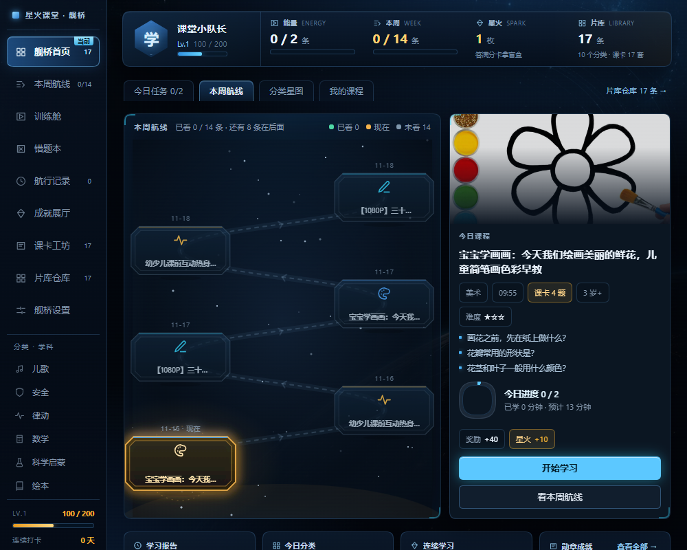
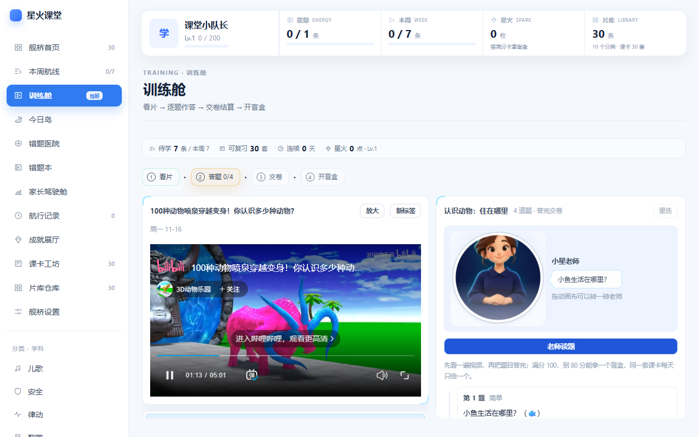
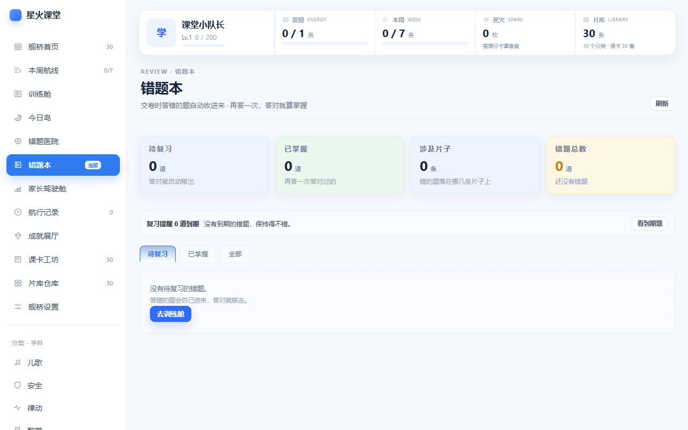
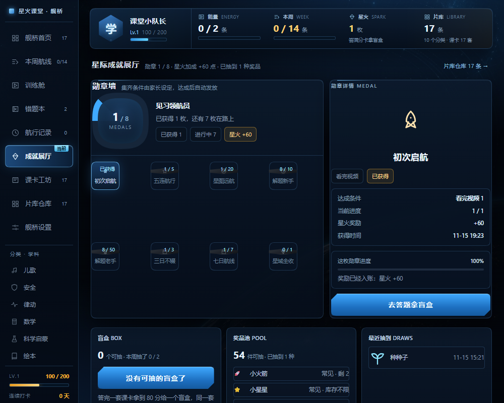

# 星火课堂 · dsh-bili-lesson

**中文** | [English](./README.en.md)

给自家孩子用的 B 站学习面板，装在 [DeepSeek Harness](https://github.com/deepseek-ai) 桌面端侧栏里：
**家长挑片 → 按周排课 → 孩子看完打勾 → 配一套课卡 → 交卷判分 → 错题回炉 → 盲盒与勋章**。

不是推荐算法 —— 片子家长手选，题目家长定稿（0.9.0 起可按片名生成本地草稿再改），插件只负责那台「排课 + 打卡 + 判分 + 奖励 + 成长」的机器。数据全在本机，无云账号、无遥测。



## 它能干什么

| 页面 | 干什么 |
|---|---|
| 舰桥首页 | 今日任务 / 本周弧形航线 / 分类星图；右侧「当前课程」卡带封面、学习目标、进度与「开始学习」 |
| 今日岛 | 给孩子看的今日任务岛：看过的进度推着火箭绕岛走，全部完成点亮灯塔 |
| 错题医院 | 把错题画成小怪兽，答对一次掉血、连对两次进康复图鉴 |
| 家长驾驶舱 | 5 个信号 + 一句可执行的建议；本周成长海报本地生成，不上传；同样受 PIN 锁保护 |
| 片库仓库 | 粘 BV 号或整条 B 站链接即入库，分类、最低年龄、推荐理由自己填；「校验失效」批量探活 |
| 本周航线 | 一周 7 天排片，可「自动排」（按分类轮转、跳过失效、跳过最近三周排过的）或手动换 |
| 航行记录 | 按天打勾，本周条数、连续打卡、近 7 天柱状图 |
| 训练舱 | 左侧官方播放器 + 本周片单，右侧课卡；逐题作答、交卷判分，答满 80 分当天给一个盲盒 |
| 错题本 | 交卷答错的题自动收进来，点选项当场重做，答对即「已掌握」 |
| 家庭周聚合（接口） | `GET /bili-lesson/family/weekly` 只读汇总一周看片、答题、错题康复、勋章与盲盒；家长驾驶舱和成长海报都从这里取数 |
| 成就展厅 | 8 枚勋章（按门槛自动发放，未得显示进度）+ 盲盒 + 奖品池 + 最近抽到 |
| 课卡工坊 | 一条视频一套卡，每套 3–8 题 |
| 舰桥设置 | 每天几条 / 默认年龄 / 每周抽盒上限；奖品池 54 件的库存与权重；勋章门槛；**家长锁 PIN**；内容包导出/导入；重看新手引导 |

### 0.9.0 新增（内容自维持 → 成长叙事 → 家长动作 → 分发）

- **内容自维持**：课卡工坊「根据片名起草稿」（离线规则 + B 站公开元数据，3–8 题，家长改完再保存）；
  设置→基础设置→「内容包」可把片库+课卡导出成 JSON，拷到另一台机器导入（脱敏、不让失效片复活）。
- **成长叙事**：今日岛内嵌 8 星球成长地图（按看片/答对/连续打卡/勋章解锁）；错题按艾宾浩斯间隔 1/3/7/15/30 天回到今日岛复习；
  训练舱多一个零依赖 Canvas2D 低多边形卡通老师（口型 + 自转，不是照片级数字人）。
- **家长动作**：家长驾驶舱「如果…就…」7 条预设建议（阈值可调）+ 屏幕时间软提醒（不阻断）+ 数据主权面板（按类导出/删除，PIN 门禁）+
  文本周报/可打印页；今日岛显示护眼 chip。
- **分发成熟度**：首次打开走 4 步新手向导（欢迎/每日节奏/家长 PIN/内容起点，可跳过、可在设置重开）；
  `scripts/build-portable.mjs` 产出便携 Node 绿色包（`dist/portable/`，自带 node.exe + 一键 bat，无需 DSH/无需安装）。

明确不做：社交排行榜、云账号同步、通用题库生成器、照片级数字人。契约见 [docs/GAP2-CONTRACT.md](./docs/GAP2-CONTRACT.md) / [GAP3](./docs/GAP3-CONTRACT.md) / [GAP4](./docs/GAP4-CONTRACT.md)。

## 片子和题目从哪来

这个插件**不内置搜索**：片库家长挑、题目家长定稿（可用按片名生成的本地草稿再改）。完整做法（接口、字段、上限、会踩的坑）见
[docs/HOW-TO-CURATE.md](./docs/HOW-TO-CURATE.md)，这里是要点。

**片子**

- 在「片库仓库」粘 BV 号或整条 B 站链接 → 服务端读公开只读接口
  `GET https://api.bilibili.com/x/web-interface/view?bvid=…`（带 referer，**不带 cookie、不登录、不代理播放流**），
  拿标题 / 封面 / 时长 / UP 主；分类、最低年龄、推荐理由由你自己填，下架的标 `dead` 但不会自动删你的条目。
- 没有内置搜索：B 站搜索要 wbi 签名，直连一律 HTTP 412，所以找片放在插件外（站内搜完复制链接 / 让 AI 助手列一批 / 从别处拷 `videos.json`）。
- 数据源是**单点可替换**的：只有 `src/bili.js:20` 的 `fetchVideo(bvid)` 在跟 B 站说话。想接第三方接口（TikHub、自建代理、内网镜像）
  只改这一处；目前没有设置页里的「API / 密钥」配置项，原因见下方「已知限制」。

**题目**

- 「课卡工坊」选一条片子 → 一条视频一套卡，**3–8 题**。字段语义：`prompt`（题干，空题干会被丢掉）/ `spokenPrompt`（口语版，缺省复制题干）/
  `options`（2–6 个，**少于 2 个会静默变成「对 / 不对」**）/ `answer`（正确项下标，越界落回 0）/ `hint` / `explanation` / `difficulty`（1–3）。
- 判分每题等权，正确率 ≥80 当天给一个盲盒；答错的题按 `lessonId:qid` 进错题本。
- 三条写作原则：一题只考一个点；选项等长同构；干扰项取片子里真会混的点（比如 6 和 9）。文档里有整套真实课卡示例。
- 「根据片名起草稿」只用标题/简介/UP 主的本地规则拼题，不联网、不需要密钥；草稿可直接改。也可以直接编辑 `lessons.json`（见「数据」一节），只要 `videoId` 对得上片库的 BV 号就能被训练舱认出来。
## 要求

- DeepSeek Harness 桌面端 **0.2.2-rc.x**（在 0.2.2-rc.3 上验证过）。插件靠 cordis patch 与客户端 `__ModuleLoader__` 工厂加载，
  依赖 `@deepseek-ai/dsh-client-runtime` 注入，**平台换大版本可能要跟着改**。
- Node 24 / pnpm（用 DSH 自带的运行时即可）。插件零第三方依赖，只用 `react`。

## 装

```powershell
git clone <本仓库> dsh-bili-lesson
cd dsh-bili-lesson
pwsh -ExecutionPolicy Bypass -File .\install.ps1
```

脚本会备份 profile 的 `package.json`、把插件登记成 `link:` 依赖并加进 `dsh.profile.bundles`、跑一次 `pnpm install`。
然后**完全退出并重开 DSH 桌面端**（含托盘），侧栏出现「星火课堂」。撤销：同一命令加 `-Uninstall`。

手工等价操作：

```powershell
# 1. 编辑 $env:USERPROFILE/.dsh/profiles/desktop/package.json
#    dependencies["dsh-bili-lesson"] = "link:<本仓库绝对路径，正斜杠>"
#    dsh.profile.bundles 末尾加 "dsh-bili-lesson"
# 2. cd "$env:USERPROFILE/.dsh/profiles/desktop"; pnpm install
# 3. 重启 DSH 桌面端
```

> 装过旧名字（`@local/dsh-bili-lesson`）的，脚本会顺手清掉旧登记，不用手工删。

## 不装 DSH 也能用（独立版）

`standalone/` 里是一份不依赖宿主的运行方式：装好 Node 后双击 `standalone/start.bat`，
浏览器打开 `http://127.0.0.1:7788/` 就是同一个界面。业务代码零改动，只是把"web 服务"和"React 挂载"
这两件宿主本来替你做的事自己接上。

第一次打开会自动铺一份 30 条片子的演示库（四个主题周，每天一条），所以不是空的；0.9.0 起首次打开还会走 4 步新手引导。
适合拿去给幼儿园或家长看效果 —— 前提是那台机器上有 Node 24。没有 DSH 也能用：仓库 `dist/portable/` 是自带 node.exe 的绿色包（由 `node scripts/build-portable.mjs` 生成，90 MB，不入 git）。

## 自测

```powershell
npm run check        # node --check 服务端与客户端入口文件
npm test             # 起真 HTTP 服务跑 selftest（140 条，会真的请求一次 B 站 view 接口）
npm run check:load   # 模拟 DSH loader，确认服务端与客户端都能加载、factory id == 包名
```

## 数据

全在本机 `~/.dsh/bili-lesson/`（`BILI_LESSON_HOME` 可改）。没有云同步，没有遥测：

| 文件 | 内容 |
|---|---|
| `videos.json` | 片库，key 是 BV 号 |
| `plans.json` | 每周计划，key 是周一日期 |
| `watch.json` | 观看记录（打勾） |
| `lessons.json` | 课卡 |
| `settings.json` | 每天几条 / 默认年龄 / 内嵌播放 / 每周抽盒上限 / 家长锁 / 屏幕时长上限 / 家长规则 / 新手引导完成标记 |
| `attempts.json` | 交卷记录（每题 qid / choice / correct、得分、是否给过盲盒） |
| `mistakes.json` | 错题掌握状态 + 艾宾浩斯复习阶段（`lessonId:qid` → resolved / tries / stage / dueAt / at） |
| `rewards.json` · `honors.json` | 抽奖记录 / 已发放勋章 |
| `prizes.json` · `medals.json` | 家长改过的奖品池与勋章规则（没改过就用内置默认） |

写盘是临时文件 + rename，读到半截 JSON 当空处理，不会因为文件坏了打不开面板。

## 接口

面板与后端只通过 HTTP 说话：约定见 [CONTRACT.md](./CONTRACT.md)，学习闭环的数据契约见 [CONTRACT-LEARNING-LOOP.md](./CONTRACT-LEARNING-LOOP.md)。
所有路由都在 `/bili-lesson/` 前缀下，走 DSH 自己的鉴权（匿名请求一律 401）。

## 安全说明（请老实看完）

- **家长锁是「软锁」，不是加密**：PIN 以加盐 sha256 存在 `settings.json` 里，解锁状态在 `sessionStorage` 放 30 分钟。
  它挡的是「孩子随手点开设置改奖品」，不是「懂电脑的人」。忘了 PIN，删掉 `settings.json` 里的 `parentPin` 字段即可。
- 出站请求只有两类：B 站 `api.bilibili.com/x/web-interface/view`（拉标题/封面/时长，匿名）与封面图床。不抓弹幕、不代理播放流、不碰账号 Cookie。
- 面板内嵌播放用 `player.bilibili.com` 官方 iframe，最高约 480P；被 CSP 拦住时用「新标签打开」兜底。

## 法律与致谢

- 本仓库代码：MIT，见 [LICENSE](./LICENSE)。
- 片源与「家长手选、去算法」的策展思路来自 [bilipicks](https://github.com/limin112/bilipicks)（MIT，Copyright (c) 2026 MinLiBuilds）——谢谢。
- **B 站内容不随本仓库分发**：仓库里没有视频、音频或题目内容，只有代码与界面截图；封面是热链、播放是官方 iframe，使用时请遵守哔哩哔哩用户协议。
- 默认的 54 件奖品、8 枚勋章只是可改的示例数据，在「舰桥设置」里可以整批替换。

## 截图

| 训练舱 | 错题本 | 成就展厅 |
|---|---|---|
|  |  |  |

## 已知限制

- 片库要人工/AI 录入，插件不内置搜索：B 站搜索接口需 wbi 签名，直连 412。
- 没有「接口地址 / 密钥」这类 API 配置页：目前只有一个数据源（官方 view 接口），写死在 `src/bili.js:20`。真要接第三方接口，改这一处即可；
  但那意味着密钥明文落在 `settings.json`，所以没有做成设置项，等你确实需要再说。
- 课卡草稿是本地规则拼的，不是 AI 代写：题目仍由家长定稿，避免给孩子出没把握的题。
- 单机单 profile，没有多孩子档案，也没有云备份；换机器用设置里的「内容包」导出/导入，或手动拷 `~/.dsh/bili-lesson/`。